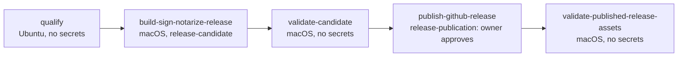

# Apple Signing, Notarization, and How WorkSpaces Ships

This page explains why a macOS release needs the credentials it does and how the
WorkSpaces release pipeline uses each one. [`RELEASING.md`](../../RELEASING.md)
holds the commands; this page holds the model those commands assume.

## The question every release answers

A downloaded Mac app is checked by **Gatekeeper** the first time it opens.
Gatekeeper asks two things: who built this, and has Apple looked at it? A
release answers the first with a **code signature** made by a Developer ID
certificate, and the second with a **notarization ticket** issued by Apple.
WorkSpaces also updates itself through **Sparkle**, which asks a third question
on every update: did the same publisher sign this update? Sparkle answers that
with its own key, unrelated to Apple's.

Every credential below exists to answer one of those three questions.

## Apple's model

### Identity: the Developer ID certificate

An Apple Developer Program membership gives a team (WorkSpaces ships from team
`LKVN4J3C6C`) the right to create a **Developer ID Application** certificate.
That certificate type is the one Apple accepts for apps distributed outside the
App Store; Apple Development and Mac App Distribution certificates do not
notarize.

A certificate is a public half that Apple signed and a private key that only
its owner holds. The private key is created on the Mac that requested the
certificate and normally never leaves that Mac's Keychain. To sign anywhere
else, such as a CI runner, the pair is exported together as a **`.p12`** file,
encrypted with an export password. The `.p12` and its password are therefore
two separate secrets, and both are needed.

Developer ID certificates are valid for five years. Because each signature
carries a secure timestamp, apps signed before expiry keep opening afterwards;
only new signing needs a renewed certificate.

### The code signature

`codesign` seals each executable in the bundle, innermost first (embedded
frameworks such as Sparkle, then the app), so any later change to a signed file
breaks the seal. Two options matter for distribution:

- `--options runtime` enables the **hardened runtime**, which notarization
  requires. Exceptions the app genuinely needs, such as JIT for the terminal
  renderer, are declared as entitlements rather than by turning protection off.
- `--timestamp` asks Apple's timestamp server to countersign, which is what
  keeps the signature valid past certificate expiry.

### Entitlements and the provisioning profile

**Entitlements** are capabilities the signature claims for the app. Most are
self-declared in [`WorkspaceManager.entitlements`](../../WorkspaceManager.entitlements).
A few are restricted: Apple must grant them for a specific app ID, and the grant
travels as a **provisioning profile** embedded in the bundle.

WorkSpaces needs one restricted entitlement, `keychain-access-groups`, because
it keeps credentials in the data protection keychain. The Developer ID
provisioning profile for `com.cloudcompute.workspaces` carries that grant. An
unsigned or ad-hoc local build has no profile, so it falls back to the legacy
login keychain at runtime. Before signing, `scripts/build-release.sh` checks
that the profile names this bundle ID, this team, and the app's keychain group,
then writes exactly that group into the signing entitlements, so the signature
never claims a group the profile does not grant.

### Notarization

**Notarization** is an automated Apple service. The pipeline uploads the signed
DMG with `xcrun notarytool`; Apple scans it for malware and for signing
mistakes (missing hardened runtime, unsigned nested code, no timestamp) and, if
it passes, issues a **ticket** for that exact file. `xcrun stapler staple`
attaches the ticket to the DMG so Gatekeeper can verify it without a network
connection.

`notarytool` authenticates with an **App Store Connect API key**, not an Apple
ID password. A key is three values that must belong together:

| Value | What it is | Where it appears |
|---|---|---|
| Private key | The `AuthKey_<KEY_ID>.p8` file, downloadable once | The owner's Mac |
| Key ID | Ten characters naming the key | The `.p8` filename and the App Store Connect key list |
| Issuer ID | A UUID naming the team's API account | Above the key list in App Store Connect |

A team can have many keys, each with its own access level, and other tools
(Fastlane, Xcode Cloud) often have keys of their own. The `.p8` file and the
key ID must name the same key; a mismatched pair fails notarization with an
authentication error, not a signing error.

### Gatekeeper

On first launch Gatekeeper checks the signature against Apple's certificate
chain, then looks for a notarization ticket, stapled or fetched from Apple.
`spctl --assess` runs the same check from a terminal, and the pipeline runs it
on every candidate.

## Sparkle: a second, separate trust chain

Sparkle checks updates with an **EdDSA key pair** that has nothing to do with
Apple:

- The public key ships inside every copy of the app as `SUPublicEDKey` in
  `Info.plist`.
- The private key signs each release DMG. The signature goes into
  `appcast.xml`, the feed at `SUFeedURL` that installed apps poll.
- An installed app refuses any update whose signature does not verify against
  the public key it already has.

That last rule makes the Sparkle private key the one credential that cannot be
replaced casually. A new key pair means every existing install rejects every
future update until users reinstall by hand. Losing the key has the same
effect. Treat it like the Developer ID private key, not like a token.

Sparkle's `generate_keys` tool keeps the private key in the login Keychain
under a service of `https://sparkle-project.org` and an account name. This
project's key is stored under the account `com.cloudcompute.workspaces`, not
the tool's default, so every lookup needs
`generate_keys --account com.cloudcompute.workspaces`. Without the flag the tool
reports that no key exists. Before uploading the key anywhere, compare
`generate_keys --account com.cloudcompute.workspaces -p` with `SUPublicEDKey`.

## Where each credential lives

| Credential | Owner's copy | GitHub secret in `release-candidate` | Used by |
|---|---|---|---|
| Developer ID certificate and private key | `Developer_ID_Application_<TEAM_ID>.p12` | `APPLE_DEVELOPER_ID_CERT_BASE64` | Code signing |
| `.p12` export password | Password manager | `APPLE_DEVELOPER_ID_CERT_PASSWORD` | Importing the `.p12` on the runner |
| Developer ID provisioning profile | `workspaces.provisionprofile` | `APPLE_DEVELOPER_ID_PROVISIONING_PROFILE_BASE64` | Keychain-sharing entitlement |
| App Store Connect private key | `AuthKey_<KEY_ID>.p8` | `APPLE_API_KEY_BASE64` | Notarization |
| App Store Connect key ID | The `.p8` filename | `APPLE_API_KEY_ID` | Notarization |
| App Store Connect issuer ID | App Store Connect, Integrations page | `APPLE_API_ISSUER_ID` | Notarization |
| Sparkle EdDSA private key | Login Keychain, account `com.cloudcompute.workspaces` | `SPARKLE_PRIVATE_KEY` | Signing the appcast |

The owner's files conventionally live in `~/.config/apple/`. GitHub stores
secrets write-only: nothing, including the API, can read a value back, so a
secret can only be re-created from the owner's copy.
[`scripts/setup-release-secrets.sh`](../../scripts/setup-release-secrets.sh)
does that from the files, verifying the `.p12` before uploading.

## How a release runs

`scripts/release.py` opens a metadata PR that changes only `CHANGELOG.md` and
`Info.plist`. Once it merges and CI passes on that exact commit,
`.github/workflows/release.yml` takes over:



| Job | Holds secrets | What it does |
|---|---|---|
| `qualify` | None | Checks the source: CI passed on this commit, every PR since the last release was independently approved, main has not moved past the metadata commit, and the environments are configured as below. |
| `build-sign-notarize-release` | All seven | Imports the `.p12` into a throwaway keychain, builds and signs the app with the embedded profile, notarizes and staples the DMG, signs the appcast with the Sparkle key, seals the candidate's hashes, uploads it as an immutable artifact, then deletes the keychain. |
| `validate-candidate` | None | Downloads the sealed artifact and checks the installer it actually contains. Its summary carries the candidate download. |
| `publish-github-release` | None | Waits for the owner's approval, then publishes the same bytes it validated. Nothing is rebuilt after approval. |
| `validate-published-release-assets` | None | Downloads the public release and the live appcast and checks them against the approved candidate. |

Signing happens before the approval on purpose. The owner approves a finished,
tested installer and can download it first, rather than approving permission to
start building one.

## Why three environments

A GitHub **environment** scopes secrets and approval rules to the jobs that
declare it. Repository-wide secrets would be readable by any workflow on any
branch; environment secrets are readable only by a job that names the
environment and passes its branch policy.

| Environment | Secrets | Branch policy | Approval |
|---|---|---|---|
| `release-candidate` | All seven signing secrets | `main` only | None |
| `release-publication` | None | `main` only | Owner |
| `release` (legacy) | The older copies | — | Owner, permanently |

`release-candidate` signs without asking because the job that reads its
secrets cannot publish anything. `release-publication` asks because it is the
step that changes what users download, and it holds no signing material.
`release` is the environment the pre-September 2026 workflow used. It keeps its
approval so that rerunning an old workflow run cannot publish around the new
gate.

`scripts/release-environments.py check` verifies this shape during `qualify`,
and `apply` creates it. `apply` lifts the approval on `release-candidate` only
once every signing secret is present.

## The review proof and the maintainer allowlist

`qualify` refuses a release unless every PR merged since the previous stable
release has an independent approving review on its final commit. A PR merged
without one can be vouched for by the owner at dispatch time:

```bash
gh workflow run release.yml --ref main -f channel=stable -f maintainer_reviewed_prs=101,102
```

The numbers are recorded in the release manifest as owner-signed rather than
reviewed. The automatic release path takes no inputs, so an unattended release
still needs a real approval on every PR.

## Rotating or replacing a credential

| Credential | When | How |
|---|---|---|
| Developer ID certificate | Before it expires, or if the private key leaks | Create a new certificate, export a new `.p12`, run `setup-release-secrets.sh --force`. Revoking the old one is only for a leak, since revocation can affect already-shipped builds. |
| `.p12` password | With the `.p12` | Same command. |
| Provisioning profile | When it expires or the app ID's capabilities change | Regenerate in the Apple Developer portal, then the same command. |
| App Store Connect key | If the `.p8` leaks, or to narrow access | Create a new key, re-upload all three API values together, then revoke the old one. `xcode-cloud-logs` holds its own copies of the same three names; update them too if it uses the same key. |
| Sparkle key | Only if it is compromised | Plan a migration first. Existing installs only trust the current public key. |

## Pitfalls seen in practice

- **A one-time setup step was skipped.** The September 2026 move to
  `release-candidate` required loading secrets into the new environment.
  That step never ran, so `qualify` failed its environment check with
  "Candidate signing still requires approval" until the secrets were loaded in
  November 2026. Run
  `release-environments.py check --settings` after any change to environments
  or secrets.
- **The API key file and key ID came from different keys.** Choosing a `.p8`
  from a list of similar files is easy to get wrong. Check that the filename
  contains the key ID you enter.
- **`generate_keys` reported no Sparkle key.** The key exists under the
  project's account name; pass `--account`.
- **A merge landed between the metadata commit and the dispatch.** `qualify`
  requires the dispatched commit to be the metadata commit itself. Hold merges
  to `main` until the dispatch qualifies.

## Further reading

- [`RELEASING.md`](../../RELEASING.md): commands, recovery, and verification
- [Release approval retrospective](../retros/2026-09-07-release-approval-contract.md):
  why signing moved ahead of the approval
- Apple: [Notarizing macOS software before distribution](https://developer.apple.com/documentation/security/notarizing-macos-software-before-distribution)
- Apple: [Developer ID](https://developer.apple.com/developer-id/)
- Sparkle: [Publishing an update](https://sparkle-project.org/documentation/publishing/)
